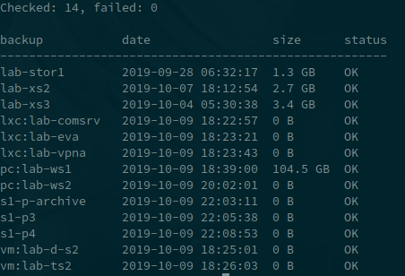

# bakauditor - Backup Auditor

## What is this

**bakauditor** is an automatic backup auditor robot.

All of us have backups. Every day something is backing up on background of our
desktops and somewhere on our servers. But what if backup has been failed and
you haven't even received an alert about it? Probably you'll find you miss
important backups only when your system is crashed and you need them.

People, who faced this problem at least once in a life, usually manually audit
their backups from time to time. That's why I've decided to automate this
boring stuff once and forever and created **bakauditor**.

## What can it do

Currently, **bakauditor** supports backup audit via plugins:

* **file** check backup, stored in file (modification time, min. size etc.)

* **dir** get most recent file in directory and check it like **file** does

* **zfs** check if ZFS snapshots exists on local or remote system

* **borg** borg backup repositories, local or remote

## How to use

Just run

```shell
bakauditor
```

and it will show you list of all your backups and their status.



You may also run

```shell
bakauditor -x
```

In this case, only failed backups are printed, otherwise you get a message:

```
Checked: 14, failed: 0

All backups are fine
```

**bakauditor** process exits with code *0* when everything is fine, and with
error codes when something is wrong. So you may just get its output and send
via e-mail or what you prefer when something is wrong. And e.g. weekly receive
output even if everything is fine, to check **bakauditor** is running and all
your backups are safe.

## Installation

```shell
pip3 install bakauditor
```

## Configuration

Put configuration file to */usr/local/etc/bakauditor.yml*. This is YAML file
and it has the following sections.

### default section

```yaml
default:
    time: 2d
    min-size: 10000000
```

Options in this section apply to all backup configurations, unless overriden.

The size may be specified in bytes, you may also use suffix "K" for Kbytes
(kilobytes, not kibitytes, 1K = 1000 bytes), "M" for MBytes, "G" for Gbytes,
"T" for TBytes.

### file

Example:

```yaml
server1:
    type: file
    path: /export/backups/server1/server1.dump.gz
    time: 3d
    min-size: 10000000
```

In the above example, we ask **bakauditor** to check backup stored in the
specified file, the file should not be older than 3 days and have a minimal
size of 10 megabytes to be considered as good backup.

Options *time* and *min-size* are optional if specified in *default* section.

### directory

Example:

```yaml
server1:
    type: dir
    path: /export/backups/server1
    time: 3d
    min-size: 10000000
```

This example will to the same as previous, but automatically get the most
recent file in the specified directory and check it. Good, when you do e.g.
incremental backups.

### directory of directories

Example:
```yaml
server1:
    type: dod
    path: /export/backups/somebackup
    time: 3d
    min-size:
```

This example considers backups are stored in separate directories inside
"somebackup" directory. The program will find most recently created directory
and calculate its total size.

### zfs

Example:

```yaml
server1:
    type: zfs
    time-fmt: "snapshot-%Y-%m%-%d-%H:%M:%S"
    fs: bakpool/server1
```

Option *time-fmt* optionally decodes the snapshot creation time from its name.
If omitted, the native ZFS creation timestamp is used. Only snapshots belonging
to the exact configured file system are considered.

Option *fs* specifies file system, where snapshots are located.

Optionally, you may ask **bakauditor** to analyze ZFS snapshot on remote server
via ssh, specifying *ssh* option:

```yaml
server1:
    type: zfs
    time-fmt: "snapshot-%Y-%m%-%d-%H:%M:%S"
    fs: bakpool/server1
    ssh: root@192.168.1.77
```

This option is just converted to command *ssh <option_value> zfs list ...* so
you may specify any options for ssh program you like.

Note: *min-size* option for zfs snapshots is ignored.

### borg

Example:

```yaml
borg-local:
  type: borg
  repo: /bak
  password: 123
```

To check repo on remote system, add "ssh" option.

Note: plugin requires **borg** >= 1.1.0, for older version use *borg0* instead
(doesn't check backup size).

## TODO

plugins for

* bacula
* HP Data Protector
* VMWare DP
* Acronis
* etc.

## Python and failure handling

Requires Python 3.10 or newer. Install from a checkout with `python -m pip install .`.
Run tests with `python -m unittest discover -s tests -v`.

Each backup needs a positive `time` limit (possibly inherited from `default`).
An empty configuration is an error, not a successful audit. Exit codes are:
`0` all configured checks passed, `1` one or more failed, `2` invalid configuration.
Malformed backend output, failed commands and timeouts fail the affected check;
other checks continue. Backend error output is not echoed, to avoid disclosing
credentials. `timeout` sets the per-command timeout in seconds (default: 60).
SSH uses batch mode and a 10-second connection timeout. Existing `ssh` option
strings (including ports and identity options) are supported.

Borg freshness now uses the archive start time instead of repository modification
time. ZFS uses native snapshot creation timestamps if `time-fmt` is omitted;
explicit snapshot-name formats remain supported. `dod` measures regular-file
bytes recursively without following directory symlinks (not allocated disk blocks).

### restic

The `restic` executable must be installed locally, or on the SSH execution host.
Native restic repository URLs support SFTP, REST, S3 and other restic backends;
the optional `ssh` setting instead executes restic on a remote machine.

```yaml
restic-server1:
  type: restic
  repo: sftp:backup@backup-host:/srv/restic/server1
  time: 2d
  min-size: 1G
  host: server1
  tag: daily
  # path: /srv/data
  # password-file: /secure/restic-password
  timeout: 120
```

`host`, `path` and `tag` are optional restic snapshot filters; each accepts a
string or a list. Filter semantics are restic's (e.g. comma-separated tags for
AND, repeated tags for OR). The newest matching snapshot is chosen by its timestamp,
not output order. No matching snapshot fails the check.

Password options: inherit `RESTIC_PASSWORD` / `RESTIC_PASSWORD_FILE` from the
execution environment, set `password-file`, or set `password` in the configuration.
Prefer an environment or a protected password file; protect YAML containing secrets.
A configured password is passed through the environment locally and stdin over SSH,
not embedded in process arguments. Remote password-file paths refer to the remote
machine; other backend credentials must already be configured there. Single-line
passwords are supported when specified in YAML.

If `min-size` is set, the auditor runs `restic stats --mode restore-size` against
the exact chosen snapshot ID and compares its logical restore size, not the
compressed/deduplicated repository size. Without `min-size`, size is displayed as
`-` and the extra stats traversal is skipped.

This is a **freshness/size audit**, not proof of recoverability or integrity.
Schedule `restic check` and restoration exercises separately. See the official
[restic scripting documentation](https://restic.readthedocs.io/en/stable/075_scripting.html)
for JSON and credential environment variables.

For an integration test that initializes and backs up to a disposable temporary
repository, set `RESTIC_TEST_BIN=/absolute/path/to/restic` before running the
unit tests. This never uses your configured production repositories. CI runs
both unit and real-repository tests on Python 3.10, 3.12 and 3.14.

For repositories deliberately initialized without a password (restic 0.17+
with support for `--insecure-no-password`), set `insecure-no-password: true`.
This must be explicitly enabled per check; it is never inferred or used as a
fallback for authentication failures. It cannot be combined with `password` or
`password-file`. In this mode inherited restic password environment variables
are cleared for the child process. Existing encrypted repositories are unchanged.
